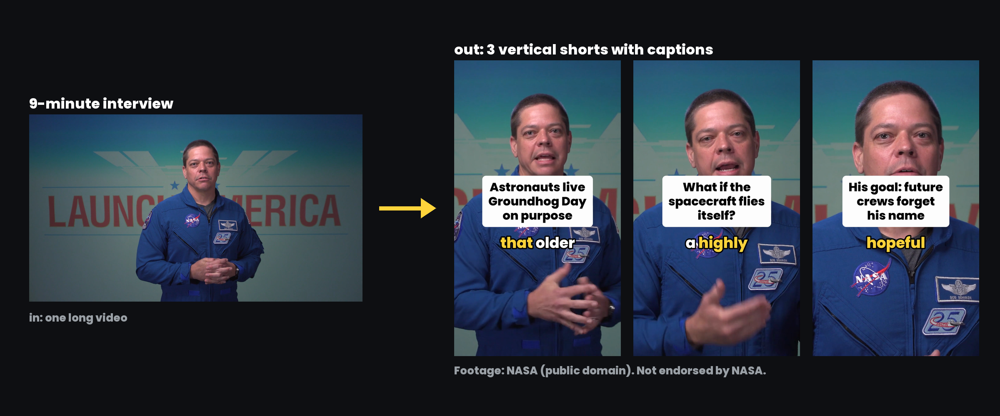

# Video to Shorts Skill for Claude Code, Codex, Cursor and OpenClaw

**Video to Shorts Skill** is a free, open-source AI agent skill that turns a long video (a podcast, interview, talk, webinar, stream or YouTube video) into vertical shorts with word-by-word captions, then posts them to TikTok, Instagram Reels, YouTube Shorts and Facebook Reels. Claude Code, Codex, Cursor, OpenClaw and other agents that run scripts use it to transcribe the video with word timestamps, score every candidate moment with a clip rubric, cut 1080x1920 clips with ffmpeg on your own machine, keep the speaker in frame, burn in captions and a hook line, write titles and captions, and post after you approve. No paid API required. MIT licensed.

```bash
npx skills add social-media-skills/video-to-shorts-skill -g -a claude-code -y
```



*One long video in, three shorts out: the first second of each clip in [`examples/nasa-interview/`](skills/video-to-shorts-skill/examples/nasa-interview/), cut from the public-domain NASA video "Bob Behnken discusses training and development in SpaceX Crew Dragon" (jsc2020m000132). Footage courtesy of NASA. This project is not endorsed by NASA.*

## Contents

- [What the video to shorts skill does](#what-the-video-to-shorts-skill-does)
- [Requirements](#requirements)
- [Install](#install)
- [Example: turn a long video into shorts in Claude Code](#example-turn-a-long-video-into-shorts-in-claude-code)
- [Transcription routes](#transcription-routes)
- [How it picks podcast clips: the clip rubric](#how-it-picks-podcast-clips-the-clip-rubric)
- [Output](#output)
- [Posting shorts to TikTok, Reels, YouTube Shorts and Facebook](#posting-shorts-to-tiktok-reels-youtube-shorts-and-facebook)
- [What it won't do](#what-it-wont-do)
- [FAQ](#faq)
- [What's inside](#whats-inside)
- [License and credits](#license-and-credits)

## What the video to shorts skill does

Tell your agent "turn this video into shorts" or "clip my podcast" and it runs the whole job:

1. **Checks the machine.** `check_setup.py` reports ffmpeg, Pillow, the transcription routes and OpenCV, with the install command for your system.
2. **Checks the footage.** It asks whether the video is yours or you have permission. No permission, no clips.
3. **Transcribes** with word timestamps, using the cheapest route you have: an existing SRT or VTT file, free local transcription, or your own Groq or OpenAI key.
4. **Finds the moments.** It reads the whole transcript, lists 8 to 12 candidates, scores each one out of 100 with the clip rubric, and shows you a table (start, end, length, hook line, score, why). You pick, usually 3 to 5.
5. **Trims each clip** to start on the strongest line, not the warm-up, and end on the last strong sentence, snapped to word edges.
6. **Previews the framing** with three frames per clip and the planned vertical crop, so you can fix a crop that misses the speaker before anything renders.
7. **Renders** 1080x1920 clips: pauses over 0.45 seconds removed, the speaker kept in frame, word-by-word captions inside the area no platform covers, a hook line for the first 3 seconds, audio normalised to -14 LUFS.
8. **Writes the text:** a hook of 3 to 8 words, a YouTube Shorts title under 70 characters, and a TikTok and Reels caption with the search phrase first and 3 to 5 specific hashtags.
9. **Posts after you say yes** through WoopSocial, one post per clip per platform, now or scheduled.
10. **Reads the results back** after 3 to 7 days and logs them in `clips-log.md`, so the next batch comes from the parts of the video that worked.

## Requirements

Python 3.8 or newer, ffmpeg (any build) and Pillow. Captions are drawn with Pillow and laid over the video, so ffmpeg needs no subtitle or text filters and the default package on every system works. The skill runs on Mac, Windows and Linux; a CI workflow renders test clips on all three.

| System | ffmpeg | Pillow |
|---|---|---|
| macOS | `brew install ffmpeg` | `pip install pillow` |
| Windows | `winget install ffmpeg` | `pip install pillow` |
| Linux (Debian, Ubuntu) | `sudo apt install ffmpeg` (or your distro's package manager) | `pip install pillow` |

Optional:

- `pip install faster-whisper` for free, private transcription on your own computer.
- `GROQ_API_KEY` or `OPENAI_API_KEY` for fast transcription with your own key.
- `pip install opencv-python-headless` to find and centre one speaker automatically.

Run `python3 skills/video-to-shorts-skill/scripts/check_setup.py` to see what your machine has and what's missing.

The skill needs an agent that can run ffmpeg on your computer (Claude Code, Codex, Cursor, OpenClaw or similar). It does not render real videos inside a browser chat sandbox.

## Install

**Claude Code**

```bash
npx skills add social-media-skills/video-to-shorts-skill -g -a claude-code -y
```

**Codex, Cursor and other agents:** run `npx skills add social-media-skills/video-to-shorts-skill` and pick your agent, or copy `skills/video-to-shorts-skill/` into your agent's skills directory.

**OpenClaw (ClawHub):** `openclaw skills install @social-media-skills/video-to-shorts-skill`

**GitHub CLI:** `gh skill install social-media-skills/video-to-shorts-skill video-to-shorts-skill`

**Gemini CLI:** `gemini extensions install https://github.com/social-media-skills/video-to-shorts-skill`

## Example: turn a long video into shorts in Claude Code

```
You:   Turn interview.mp4 into shorts for my TikTok and YouTube.

Agent: ffmpeg and Pillow are ready, faster-whisper is installed. Two
       questions: is the footage yours or do you have permission, and do
       you have an .srt from YouTube Studio?

You:   It's ours. No srt.

Agent: Transcribing locally with the small model. Candidates scored.
       Top 3:
       1. 8:14 to 8:45, 86, "Astronauts live Groundhog Day on purpose"
       2. 3:38 to 3:54, 82, "What if the spacecraft flies itself?"
       3. 1:15 to 1:40, 76, "His goal: future crews forget his name"
       Dropped 0:46 to 1:10 (48): abstract, opens with "And so".
       Which ones?

You:   All three.

Agent: Framing previews look right, one speaker centred. Rendered 3 clips.
       Warning: clip 01 is 73 s; keep it under 60 s if any music or
       footage isn't yours. Contact sheet attached. Post plan: 3 clips to
       TikTok and YouTube, staggered over three days. Go ahead?

You:   Yes.
```

The transcript, `clips.json`, contact sheet and manifest for this run are in [`examples/nasa-interview/`](skills/video-to-shorts-skill/examples/nasa-interview/). The source video isn't in the repo; [`CREDITS.md`](skills/video-to-shorts-skill/examples/nasa-interview/CREDITS.md) links to it.

## Transcription routes

| Route | How | Cost and speed |
|---|---|---|
| Existing transcript | `--from captions.srt` (SRT or VTT) | Free and instant; word timing is estimated, so captions are a little less tight |
| Groq | `GROQ_API_KEY` set | About $0.04 per hour of audio, a minute or two per hour; the audio goes to Groq |
| OpenAI | `OPENAI_API_KEY` set | whisper-1, which OpenAI plans to retire in February 2027 |
| Local | `pip install faster-whisper` | Free and private; roughly half to one times the video's length on a laptop with `--model small`, faster with `--model base` |

```bash
python3 scripts/transcribe.py VIDEO --out work/
```

It writes `work/transcript.txt` (one timestamped line per sentence, compact enough for an agent to read an hour of video) and `work/transcript.json` (every word with start and end times).

## How it picks podcast clips: the clip rubric

**Hard gates.** Fail one and the moment is out:

- The first sentence makes sense with no context (no "like I said", no "he" pointing at nobody).
- One complete idea.
- No intro, outro, sponsor read, housekeeping or long crosstalk.
- No music or footage you don't own.

**Score out of 100:**

| Criterion | Points |
|---|---|
| Hook in the first 3 seconds | 25 |
| Stands alone for a stranger | 20 |
| Payoff or turn | 20 |
| Emotion and energy | 15 |
| Specifics: numbers, names, a story | 10 |
| Strong last line | 10 |

70 and up ships, 55 to 69 goes to you as a maybe, below 55 is dropped.

**Lengths.** 25 to 45 seconds by default, 60 at most; up to 90 only for a story scoring 85 or more. Clips with any third-party music or footage stay at 60 seconds or less, because YouTube blocks longer Shorts that get a Content ID claim. YouTube Shorts and TikTok's posting API cap a clip at 3 minutes.

**Spread.** No overlapping clips, clips from across the whole video, one per sub-topic. The full rubric with worked examples is in [`references/clip-rubric.md`](skills/video-to-shorts-skill/references/clip-rubric.md).

## Output

`scripts/make_shorts.py` turns a `clips.json` file into finished shorts:

```bash
python3 scripts/make_shorts.py clips.json --transcript work/transcript.json --out shorts/ --preview
python3 scripts/make_shorts.py clips.json --transcript work/transcript.json --out shorts/
```

- **Video:** 1080x1920 at the source frame rate, H.264 High, AAC 48 kHz stereo, moov at the front. One file that TikTok, Instagram Reels, YouTube Shorts and Facebook Reels all accept, about 4 to 9 Mbps.
- **Framing:** `crop` places a 9:16 window on the speaker (found with OpenCV, or set by hand with `focus_x`); `fit` shows the whole frame on a blurred copy of itself for two speakers, screen shares and wide shots. A vertical source is just scaled.
- **Captions:** Poppins ExtraBold at a fixed 96 px, white with a black outline, up to three words at a time on one line, the spoken word in your accent colour (default #FFD43B), centred on the frame and kept inside x 180 to 900, y 290 to 1250, so no platform's buttons or text cover them.
- **Hook:** 3 to 8 words, black on a white rounded box, for the first 3.5 seconds (shown again halfway in clips over 40 seconds).
- **Audio:** high-pass at 80 Hz, -14 LUFS with a -1 dB true-peak ceiling, 10 ms fades at every cut.
- **Pauses:** gaps over 0.45 seconds removed with 0.12 seconds of air kept around words (`"tighten": true`).
- **Files:** `clip-01.mp4` and onward, a cover frame per clip, `contact-sheet.jpg`, and `manifest.json` with byte sizes, durations, texts and warnings.

Re-render one clip with `--only 02`. `--best` encodes slower and slightly smaller. Full specs: [`references/shorts-specs.md`](skills/video-to-shorts-skill/references/shorts-specs.md).

## Posting shorts to TikTok, Reels, YouTube Shorts and Facebook

Posting goes through [WoopSocial](https://woopsocial.com/?utm_source=video-to-shorts-skill&utm_medium=readme), a social media API and MCP server for AI agents. Disclosure: this skill is maintained by Frank Heijdenrijk and the team behind WoopSocial. The free plan covers 2 social accounts with everything included. Setup steps for every agent are at [woopsocial.com/agents](https://woopsocial.com/agents?utm_source=video-to-shorts-skill&utm_medium=readme).

The agent uploads each clip, builds one post per clip per platform (TikTok video, Instagram Reel, YouTube with a title and privacy setting, Facebook Reel), validates every post, and shows you one table with clip, platform, account, text and time with timezone. It posts only after a clear yes. With several accounts, each account gets its own clips or at least its own hook and caption, and the times are staggered.

WoopSocial doesn't write captions and doesn't crop or reformat media. The skill does both: it writes the text and renders the vertical clips itself. If you'd rather not connect anything, it hands you the clips, titles and captions to post yourself.

## What it won't do

- Clip a video you don't own or have permission to use. It asks first and stops without a yes.
- Post the identical clip at the same time to many accounts.
- Invent quotes, numbers or claims in hooks, titles or captions. They say what the clip says.
- Post anything before you approve the clips, text, accounts and times.
- Download videos from YouTube. Use your own file, or the download from YouTube Studio for your own videos.
- Estimate numbers a platform didn't report. Missing means "not reported", not zero.

## FAQ

**How do I turn a long video into shorts?**
Install the skill, then ask your agent to "turn video.mp4 into shorts". It transcribes the video, scores the best moments, shows you a shortlist, renders the ones you pick as 1080x1920 clips with captions and posts them after you approve.

**Can Claude Code make shorts from a YouTube video?**
Yes, from a video file on your computer. For your own YouTube videos, download the file (and the .srt, if you have one) from YouTube Studio and point the skill at it. The skill doesn't download videos from YouTube.

**How do I make podcast clips with captions?**
The skill transcribes the episode with word timestamps and burns in word-by-word captions, two or three words at a time with the spoken word highlighted. For a two-person video podcast it uses the `fit` layout or one clip per speaker.

**Do I need a paid API for transcription?**
No. Local transcription with faster-whisper is free and private, and an existing SRT or VTT file costs nothing. A Groq key is faster, at about $0.04 per hour of audio.

**How long should a short be in 2026?**
The skill aims for 25 to 45 seconds and allows up to 60, or 90 for a story that earns it. YouTube Shorts and TikTok's posting API allow up to 3 minutes, but a Short over 60 seconds with any Content ID claim is blocked on YouTube.

**Does it work on Windows and Linux?**
Yes. It needs Python 3.8+, ffmpeg (any build) and Pillow, and a CI workflow tests rendering on Mac, Windows and Linux.

**Can I post the same clip to many accounts?**
The skill won't post the identical clip to many accounts at the same time. It gives each account its own clips or its own hook and caption, and staggers the times.

**Is it free?**
The skill is MIT licensed and free. Posting through WoopSocial is free for 2 social accounts; more accounts need a paid plan.

## What's inside

All of it lives in [`skills/video-to-shorts-skill/`](skills/video-to-shorts-skill/):

| File | What it does |
|---|---|
| `SKILL.md` | The workflow the agent follows |
| `scripts/check_setup.py` | Checks ffmpeg, Pillow, transcription routes and OpenCV, with install commands |
| `scripts/transcribe.py` | Transcribes with word timestamps (existing SRT/VTT, Groq, OpenAI or local faster-whisper) |
| `scripts/make_shorts.py` | Cuts, frames, captions and normalises the clips; writes covers, contact sheet and manifest |
| `scripts/upload_parts.py` | Uploads a clip to a WoopSocial upload session |
| `references/clip-rubric.md` | Hard gates, scoring, lengths, start and end rules, hook text |
| `references/shorts-specs.md` | Frame, caption and audio specs, safe area, reused content rules |
| `references/woopsocial.md` | Connect, upload, post and read results |
| `fonts/` | Poppins (SIL Open Font License) |
| `examples/nasa-interview/` | A worked example on public-domain NASA footage |
| `evals/evals.json` | Test scenarios for the skill |

## More free social media skills

More skills for social media work: [social-media-skills.com](https://social-media-skills.com)

## License and credits

MIT. Poppins is under the SIL Open Font License (`skills/video-to-shorts-skill/fonts/OFL-Poppins.txt`). The example footage is the NASA video "Bob Behnken discusses training and development in SpaceX Crew Dragon" (jsc2020m000132), from [images.nasa.gov](https://images.nasa.gov/details/jsc2020m000132_Bob_Behnken_discusses_training_and_development_in_SpaceX_Crew_Dragon). NASA material is generally not subject to copyright in the United States; this project is not endorsed by NASA.
